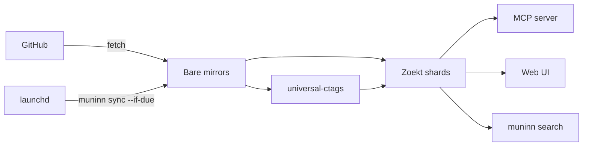

# muninn

**Local code search across all your GitHub repos, for you and your agents.**

muninn is a single Go binary that mirrors your GitHub repos, indexes them with [Zoekt](https://github.com/sourcegraph/zoekt) and universal-ctags, and serves the index three ways: an MCP server for coding agents, a keyboard-driven web UI, and a terminal search. It runs on your laptop with no database, no Docker and nothing resident: sync is a scheduled job that exits, and the MCP server shuts itself down when no agent is using it.

Named for Odin's raven, who flies out over the world and brings back memory.

## Why muninn

I used [Sourcebot](https://github.com/sourcebot-dev/sourcebot) locally for months and liked it, but running it in Docker Compose alongside Postgres and Redis kept my laptop running hot for an enterprise-ready tool only I was using. muninn keeps the parts I relied on and drops the server stack:

| | Sourcebot (local) | muninn |
|---|---|---|
| What you run | Docker Compose with Postgres and Redis | One binary |
| When it's running | Always | Only during a sync, an agent session or a web UI session |
| Agent access | MCP | MCP, with every session sharing one server (17 sessions in about 127 MB) |
| Config | Sourcebot schema | A compatible subset; an existing Sourcebot config migrates with small edits |
| Web UI | General-purpose | Built around my workflow: GitHub permalinks, open in Cursor or VS Code, a ⌘K palette |

If you need shared, multi-user code search for a team, Sourcebot is the better fit. muninn is for one person's machine.

## Quickstart

muninn runs on macOS, since scheduling uses launchd. Homebrew also installs `git` and [universal-ctags](https://github.com/universal-ctags/ctags), which symbol search depends on. The [GitHub CLI](https://cli.github.com) is optional, but it's the most reliable way to authenticate.

```bash
brew install broderick-westrope/tap/muninn gh
gh auth login
```

Without Homebrew, `go install github.com/broderick-westrope/muninn@latest` works, given `git` and a universal-ctags built with `+interactive`. Also install `github.com/broderick-westrope/muninn/cmd/muninn-mcp-proxy@latest`, or each agent session costs about 30 MB instead of 3 MB.

Tell muninn what to index in `~/.config/muninn/config.json`:

```json
{
  "connections": {
    "github": {
      "type": "github",
      "orgs": ["your-org"],
      "repos": ["you/side-project"],
      "exclude": { "archived": true }
    }
  }
}
```

Run the first sync, then let launchd keep the index fresh:

```bash
muninn sync            # clone mirrors and build the index (the first run takes a while)
muninn sync --install  # resync in the background every hour
muninn web             # search in the browser
```

To give an agent access, add muninn as an MCP server. For Claude Code that's `claude mcp add muninn -- muninn mcp`; most other clients take this JSON:

```json
{ "mcpServers": { "muninn": { "command": "muninn", "args": ["mcp"] } } }
```

See [docs/configuration.md](docs/configuration.md) for every config field, token sources and editor integration.

## Using it

### Web UI

`muninn web` serves the UI at `127.0.0.1:7576` and opens it in your browser. Search uses Zoekt's query syntax (`sym:NewServer case:yes repo:muninn`), the sidebar filters by repo and file type, and every file links to a GitHub permalink pinned to the indexed commit. If you have a checkout of the repo locally, it also opens in Cursor or VS Code.

| Key | Does |
|---|---|
| ⌘K | Command palette: open a file, jump to a symbol, run any command |
| ⌘G | Go to a line or range in the open file |
| `/` | Focus search |
| Esc | Back to results |
| Shift+⌫ | Clear filters |
| Shift-click a line number | Select a range for the permalink |

In the palette, type a file name to open it, and add `:15` or `:10-20` to land on a line or range. Start with `@` for symbol definitions, `:` for a line in the open file, or `>` for commands only, and add `repo:<regex>` to narrow a name that many repos share. Off macOS, use Ctrl in place of ⌘.

### MCP

Agents get ten tools: `grep`, `glob`, `list_repos`, `read_file`, `list_tree`, `find_symbol_definitions`, `find_symbol_references`, `search_commits`, `get_diff` and `blame`. Reads are pinned to the indexed commit, so line numbers always agree with search results. [docs/mcp.md](docs/mcp.md) describes each tool and how the shared server works.

### Terminal

```bash
muninn search "sym:NewServer case:yes repo:muninn"
muninn search --files-only "file:_test\.go$ repo:muninn"
muninn status   # last sync, per-repo failures, scheduler state
```

## How it works



Each sync fetches bare mirrors, rebuilds Zoekt shards with ctags symbols, and removes repos that are no longer configured. Mirrors and the index live under `~/.local/share/muninn/`, and sync status and logs under `~/.local/state/muninn/`; both honor `XDG_DATA_HOME` and `XDG_STATE_HOME`.

The launchd job wakes every few minutes but only syncs when the index is stale, retries quickly after a failure, and never reports a broken sync as fresh. [docs/scheduling.md](docs/scheduling.md) has the details.

## Troubleshooting

| Symptom | Check |
|---|---|
| Results look out of date | `muninn status` shows each repo's age and the last failure. `muninn sync` runs one now. |
| Scheduled syncs fail on auth | A token that only exists in your shell isn't visible to launchd. Run `gh auth login`, then `muninn sync --install` again. |
| Symbol search finds nothing | ctags is missing or lacks `+interactive`. Check `ctags --list-features`. |
| An agent's muninn tools hang or fail | `muninn mcp --in-process` bypasses the shared server. Its log is `~/.local/state/muninn/mcp.log`. |
| No "Open in Cursor" button | muninn only offers it for repos it finds a checkout of under `editor.roots`. |

## Development

```bash
go build ./...
go test ./...
```

[docs/development.md](docs/development.md) covers the web UI's JavaScript tests and how releases are cut.
