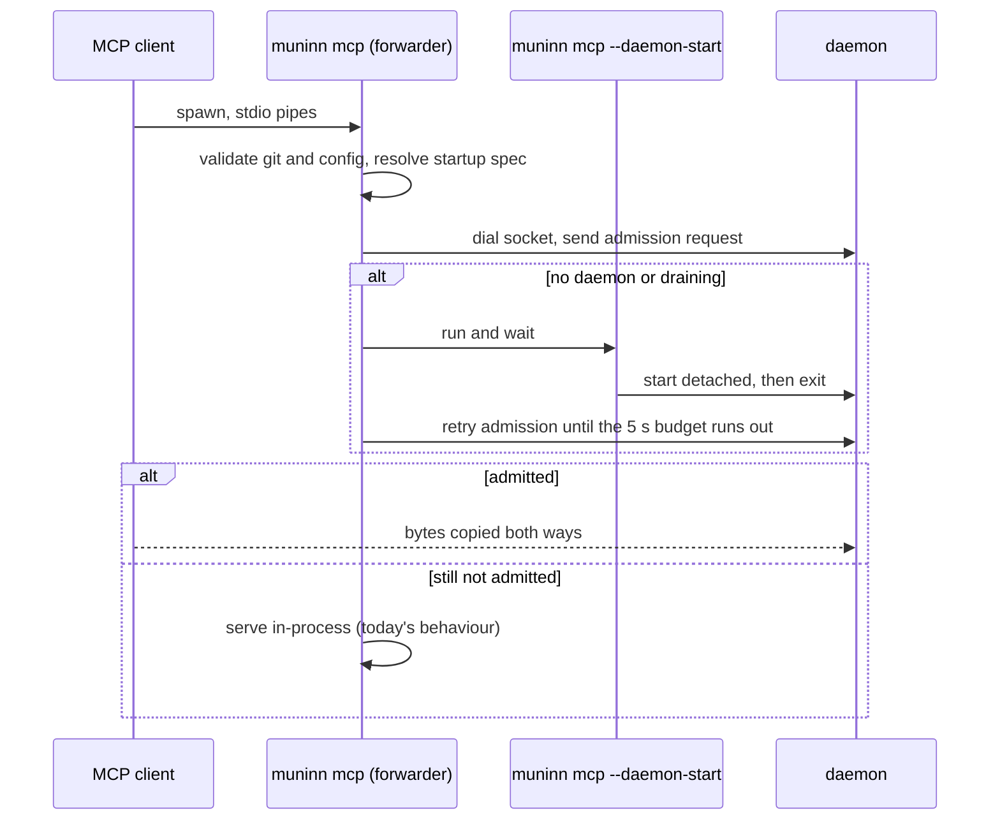

# Muninn Design: One Shared MCP Server for Every Client

**Status:** Built on `feat/shared-mcp-daemon` (all three phases); see
[Implementation Notes](#implementation-notes) for where it differs from
this design. Numbers marked "measured" were taken on 2026-10-20 on one
machine (316 repos, 875 MB index, macOS `footprint`); everything else is
projected.

## TL;DR

Every agent session runs its own `muninn mcp`, and 17 of them cost about
1 GB. Fix it in three phases that each ship on their own, and stop when
the measured footprint is good enough:

1. Give `muninn mcp` a default soft memory limit (about 1 GB to 765 MB).
2. One daemon per user and index, reached over a Unix socket, with
   `muninn mcp` as a forwarder (to about 500 MB).
3. Move the forwarder into a small standard-library-only binary that
   `muninn mcp` execs into (to about 110 MB).

Client configs never change. Phase 3 exists because any process that
links Zoekt pays about 26 MB at package init before `main` runs, so a
forwarder inside `muninn` can't be small.

## Problem

Every MCP client session starts its own `muninn mcp`, and each one opens
its own Zoekt searcher over the whole index. On 2026-10-20 one machine
had 17 of them, one per Anvil instance, at 55–61 MB each. That's about
1 GB of duplicated read-only state, and at a fixed index size it grows
with the number of agent sessions. Anvil's ADR 0005 (cross-instance
sharing) decided that muninn's sharing belongs in muninn so every MCP
client benefits, which rules out solving it inside Anvil.

### What one process costs

Measured scenarios, each a separate run, so the rows are not an additive
breakdown:

| Process | Footprint | Live heap after GC |
| --- | --- | --- |
| `muninn mcp`, idle after `initialize` | 61 MB | |
| `muninn mcp` after two `grep` calls | 71 MB | |
| `muninn mcp` with `GOMEMLIMIT=32MiB`, after two `grep` calls | 45 MB | |
| Searcher opened over all 316 shards, one search run | | 22 MB |
| Go binary that only imports the `zoekt` root package | 26 MB | 12–13 MB |
| Go binary that only imports `internal/cli` | 26–30 MB | 13 MB |
| Standard-library-only Go binary copying stdin to a Unix socket | 3 MB | |

Shard pages are file-backed and clean, so the OS already shares them and
they don't appear in footprint.

The package-init cost can't be avoided from inside muninn: the `zoekt`
root package imports `query`, which imports `languages` and with it
go-enry's tables, and `search` also reaches go-enry through `index`. Go
runs every linked package's `init` before `main`, so an early branch in
`main` doesn't help.

### Projected totals for 17 sessions

| After | Per session | Shared | Total |
| --- | --- | --- | --- |
| Today | 61 MB | | ~1,040 MB |
| Phase 1 (memory limit) | ~45 MB | | ~765 MB |
| Phase 2 (daemon, forwarder in `muninn`) | ~26 MB | ~61 MB | ~500 MB |
| Phase 3 (forwarder in its own binary) | ~3 MB | ~61 MB | ~110 MB |

The target is that each extra session costs a few megabytes rather than
a few dozen, which only phase 3 delivers. Phases 1 and 2 are worth
shipping on their way there, and if the owner decides 500 MB is fine,
the work stops after phase 2.

## Goals

- Many MCP clients share one searcher.
- `{"command": "muninn", "args": ["mcp"]}` keeps working unchanged in
  every stdio client (Anvil, Claude Code, Cursor).
- If the daemon can't be used, a session behaves exactly as it does
  today.

## Non-Goals

- Changing sync, indexing, or tool output.
- MCP over HTTP. No current client needs it, and on loopback it needs
  authentication that a Unix socket in a `0700` directory gets from the
  OS. It can be added to the same daemon later if a client appears that
  can't spawn a process.
- Windows or Linux service integration, and remote access.
- Fixing the pre-existing risks listed under [Risks](#risks), beyond
  making them visible.

## Alternatives Considered

| Option | Why not (or not alone) |
| --- | --- |
| GC tuning only | Kept as phase 1, but the 22 MB live heap per process is a floor it can't go below |
| Open the searcher lazily on first search | Saves the searcher only for sessions that never search, does nothing about init cost, and stops saving after the first search unless eviction is added; sessions that never search haven't been shown to be common |
| Share inside the client (one muninn per Anvil install) | Helps only that client; ADR 0005 put sharing in muninn |
| Configure clients to run the proxy directly | Allowed as an optional fast path once phase 3 exists, but can't be the default without changing every client config |

## Phase 1: Default Memory Limit

`muninn mcp` calls `debug.SetMemoryLimit` at startup unless the user has
set `GOMEMLIMIT`. The value needs a short benchmark (idle footprint, a
burst of representative tool calls, GC CPU, and latency) at 32, 48, and
64 MiB. It applies only to `muninn mcp`, never to `muninn sync`, whose
indexing legitimately needs more. The limit is soft: live data can still
exceed it, and it says nothing about mmap'd shards, so it's a GC hint
and not a ceiling. Phase 2's daemon gets its own value, benchmarked with
concurrent sessions rather than copied from the single-session one.

## Phase 2: Shared Daemon

### Timing

| Timer | Value | Owner | On expiry |
| --- | --- | --- | --- |
| Startup budget, first dial to admission, including running `--daemon-start` | 5 s | forwarder | serve in-process |
| Between daemon starts while waiting | 1.5 s | forwarder | start another daemon |
| Admission exchange | 500 ms | both | not admitted; forwarder retries within its budget |
| Wait to be reparented, then lock retry | 1 s each | daemon | exit; forwarders fall back |
| Idle before exit | 5 min | daemon | drain and exit |
| Each response write | 30 s | daemon | end that session |
| Each call | 5 min | daemon | cancel the call |

The daemon's two 1 s waits fit inside the 5 s budget. A forwarder starts
another daemon if 1.5 s after its last start nothing is admitting it,
which replaces a daemon that lost the lock race and exited.

### Forwarder

`muninn mcp` does what it does today up to the searcher: it validates
`git` and the config, so misconfiguration still fails fast in the client.
Then it resolves the session's startup spec, asks a daemon to admit it, and
on success copies stdin to the socket and the socket to stdout. The
forwarding code lives in its own package that imports only the standard
library, so phase 3 can lift it into a separate binary unchanged.

**Fallback boundary.** The forwarder doesn't read a byte of stdin until
it has been admitted. Until then, any failure (no socket, daemon never
started, admission refused, socket path too long, locking unsupported)
means it serves in-process exactly as today. After admission it never
falls back: if the daemon dies mid-session the forwarder exits non-zero,
and the client sees the server die just as it would today if
`muninn mcp` crashed. Replaying `initialize` against a new daemon can't
restore in-flight requests, so it isn't worth the complexity.

### Admission

A successful dial isn't proof of a live daemon: a connection can be
accepted, or still be queued in the listen backlog, just as an idle
daemon decides to exit. So the first thing on every connection is a
one-line exchange in muninn's own format, before any MCP bytes:

1. The forwarder sends `muninn-admit v1 <identity>\n`.
2. The daemon reads at most 256 bytes up to the newline. Under the
   mutex that guards its idle-to-draining transition it only checks its
   state and the identity, and reserves a session or refuses. It writes
   the reply after releasing the mutex, so a slow peer can't stall other
   admissions or shutdown, and drops the reservation if the write fails.
3. The reply is `ok <identity>\n` or `refused <reason>\n`. The forwarder
   reads it byte by byte up to the newline, so nothing after it is
   buffered away from the MCP stream, and accepts only an `ok` that
   echoes its own identity.

Both sides put a 500 ms deadline on the exchange and clear it before MCP
bytes flow; anything else (timeout, partial line, refusal, identity
mismatch, a stranger on the socket) counts as not admitted. A forwarder
never deletes or replaces a socket, even on mismatch: only a daemon
holding the lock may. Admission, not dial, is the point of no return.
There's no authentication beyond the socket directory's `0700`
permissions; any process that can reach the socket is already the same
user.

### Startup spec and identity

Today each `muninn mcp` resolves its own paths from its own environment.
A shared daemon keeps the environment of whichever session started it,
so the forwarder resolves everything once into a startup spec and the
daemon never re-resolves from its own environment or working directory.
The spec holds absolute paths for the index, status file, mirrors,
socket, lock, and log, plus the real path of the `muninn` binary and
the identity. The XDG helpers accept relative overrides, so every path
is made absolute against the forwarder's working directory.

Only sessions that would have resolved the same things may share a
daemon. The identity is a hash of:

- the real path of the `muninn` binary (symlinks resolved once, in the
  forwarder), plus its size and mtime;
- the spec's index, status, mirrors, and state directory paths.

The path, size, and mtime are a heuristic: they change on `brew upgrade`
(new Cellar path) and on normal rebuilds, but a metadata-preserving
replacement could keep them equal. That is accepted for a personal tool.
After an upgrade, old daemons keep serving their existing sessions and
exit when idle. Like today's long-lived `muninn mcp` processes, an old
daemon may skip shards written in a newer format by a sync that runs in
the meantime.

Config isn't part of the identity, because the MCP server doesn't use
it; the forwarder validates it so errors still surface per session.
`git` is resolved from the daemon's `PATH`. That's accepted: muninn
needs a working `git`, not a particular one.

The socket and lock live at `<state dir>/mcp-<hash>.sock` and `.lock`,
with a 16-character hash. If the socket path exceeds macOS's
104-byte `sun_path` limit, the forwarder serves in-process.

### Daemon lifecycle

1. Wait until reparented to launchd (see Detaching), so no client can
   be admitted while the daemon is still in its process tree.
2. Take the lock with `internal/lock`, retrying for up to 1 s (an
   exiting daemon may still hold it). If it's held, exit 0: another
   daemon owns this identity. If locking is unsupported, exit non-zero;
   the forwarder's admission then fails and it serves in-process.
3. Holding the lock, remove any stale socket file and listen.
4. Register all tools, then accept connections. Tool-list changes are
   broadcast to every session, so the tool set must be fixed before the
   first one connects.
5. Serve each admitted connection as its own session on one shared
   `sdk.Server`.
6. After 5 minutes with no sessions, enter draining under the admission
   mutex, close the listener, remove the socket file, and exit. The lock
   file is never removed; the kernel releases the lock with the process.

Holding the lock for the daemon's life is what makes the socket file
trustworthy: lock free means no live daemon, so a leftover socket is
stale and safe to delete. `internal/lock` opens the file close-on-exec,
so `git` subprocesses don't inherit the lock. Forwarders never touch the
lock; several racing forwarders each start a daemon, one wins, and the
rest exit within a second. A forwarder usually reaches the winner within
its budget; one that doesn't serves in-process, which costs memory but
nothing else.

**Detaching.** The forwarder runs `muninn mcp --daemon-start` and waits
for it. That process starts the real daemon in a new session (`Setsid`),
with stdin and stdout on `/dev/null`, stderr appended to the spec's log
path, and working directory `/`, passing it the startup spec, then exits
at once. The daemon then polls `os.Getppid()` until it is 1 (giving up
after 1 s) before it takes the lock and listens. From then on it isn't
a descendant of any client: a client that kills its process group or walks its process
tree on exit can't take down a daemon other sessions depend on, and a
client waiting for EOF on the server's stdout can't hang on a pipe the
daemon holds. App Sandbox and TCC behaviour for clients that run sandboxed
is unverified.

### Session end

Today, once the client closes stdin, the session is over: in go-sdk
v1.6.1 a read error marks the connection as shutting down, and every
later write, including responses to calls still running, is rejected
(`internal/jsonrpc2/conn.go`, `shuttingDown` and `write`). The first
rejected write then cancels the remaining calls. Responses in flight at
EOF are lost today, so the daemon gives up nothing by treating EOF as
the end of the session.

- **EOF for any reason** (client closed stdin, client or forwarder
  died). The forwarder half-closes the socket on stdin EOF and exits
  when the daemon closes it. The daemon gives each connection a session
  context that ends as soon as a read on it returns EOF or an error, and
  a receiving middleware on the shared `sdk.Server` links each call's
  context to it; the session context reaches the middleware as a value
  on the context passed to `Server.Connect`.
  That context's own cancellation can't do this: go-sdk wraps it so it
  never cancels (`internal/jsonrpc2/conn.go`, `notDone`), and
  request contexts derive from that wrapper. Cancelling on EOF stops
  abandoned `git` work at once instead of when its first write fails,
  which is the one improvement on today.
- **Client stops reading stdout.** Each write to a session's connection
  gets a fresh 30 s deadline. It bounds the whole write, not progress,
  which is fine because a response is a few kilobytes of text; a client
  that can't take one in 30 s is stuck, and the daemon closes its
  connection. A forwarder blocked writing to a stuck client's stdout
  just stays blocked, which only affects that client.
- **Malformed input.** A decode error stops the SDK reading, but the
  daemon only learns of it when the session's calls finish (at most the
  5 minute call bound), because it wraps the socket rather than the
  SDK's `Connection`; see Implementation Notes.

### What one process serving many sessions changes

- **Panics.** Neither the go-sdk nor `textHandler`
  (`internal/mcp/server.go:178`) recovers panics in tool handlers. Today
  a panic kills one session; in a daemon it would kill all of them.
  `textHandler` must recover and turn a panic into a tool error.
- **History calls.** `search_commits` with `changed_regex` and similar
  calls run `git` per call. A semaphore around `gitcmd`, sized to
  `GOMAXPROCS` and acquired with the call's context so a cancelled call
  stops waiting, stops 17 sessions starting 17 pickaxe scans at once.
  Zoekt's searcher is built for concurrent queries and needs no limit.
- **Unbounded work.** The SDK queues each session's calls without a
  bound, searches have no wall-time limit, and `git` output isn't
  capped. All of that is true today; the daemon concentrates it in one
  process rather than adding to it, and this design doesn't change it.
- **Logging.** The daemon logs admissions, session ends, panics, and
  Zoekt's shard-load errors to `mcp.log`. Zoekt's informational shard
  loading lines stay discarded.

## Phase 3: Forwarder Binary

`muninn-mcp-proxy` is the phase 2 forwarder package with a `main`. It is
built by goreleaser alongside `muninn` and installed next to it by the
same Homebrew formula.

`muninn mcp` still validates `git` and the config and resolves the
startup spec, then `syscall.Exec`s the proxy found next to its own
resolved executable, passing the spec and the original arguments (so
`--config` survives). The proxy resolves nothing itself. Exec keeps the
pid and the inherited stdio, nothing has been read from stdin, and the
26 MB of init heap disappears with the old process image.

When the proxy isn't admitted, it execs back into
`<resolved muninn> <original arguments>` with `MUNINN_MCP_IN_PROCESS=1`
set, which stops that from looping. (A flag appended after the original
arguments would be read as a positional argument after a `--`.) If the proxy binary is
missing (a `go install` build, say), `muninn mcp` behaves as in phase 2.

## Risks

| Risk | Status |
| --- | --- |
| One crash or out-of-memory kill drops every session at once | Accepted; panic recovery covers the common case |
| A background process outlives the session that started it, for up to 5 idle minutes | Accepted; the README says so |
| The daemon keeps the environment of the session that started it, including `GOMEMLIMIT` and any tokens in the agent's environment, for its whole life | Accepted for now; passing an allowlisted environment is a follow-up |
| Every rebuild or upgrade leaves an `mcp-<identity>.lock` behind, and `mcp.log` is never rotated | Accepted for now; both are small; sweeping stale state is a follow-up |
| A shard that fails to load during a sync is never retried: Zoekt records the new file identity before loading it (`search/watcher.go`, `scan`), so the searcher keeps the old shard until the file changes again | Pre-existing in every long-lived `muninn mcp`; a daemon serves every session from the one stale searcher. Logged to `mcp.log`; fixing it is out of scope |
| During a sync, search results and `read_file` can disagree, because the status file and the searcher's shard watcher update independently. Normally that lasts until the watcher catches up; after a failed shard load (row above) it lasts until the next sync rewrites that shard | Pre-existing and unchanged |
| Exec handoff only works on Unix | Fine while scheduling is macOS-only |

## Testing

Status after the build. Covered by automated tests unless marked.

- Two or more sessions share one daemon and get correct results
  concurrently, with and without the proxy.
- A client that goes away has its calls cancelled; other sessions are
  unaffected.
- A stale socket left by a SIGKILLed daemon is replaced by the next
  session.
- Five sessions starting at once share one daemon.
- Idle shutdown racing a connection: covered by unit tests of the gate
  (including a stale timer callback) and of `Dial` handing off from a
  draining daemon to its successor. Not covered: a connection still in
  the listen backlog at the moment of draining.
- Daemon killed mid-session: the session exits non-zero and doesn't fall
  back.
- No daemon possible (state directory unusable or open to others, the
  daemon can't open its log): the session is served in-process, with and
  without the proxy. Not covered: locking unsupported, socket path too
  long end to end (the path check is unit-tested).
- A handler panic returns a tool error (unit test of `textHandler`).
- A client that stops reading has its session ended by the write bound.
- `--config` survives both exec hops, including the proxy handing back.

## Success Measure

After each phase, open the same 17 sessions, run the same burst of tool
calls, and record `footprint` for every muninn process, idle and during
the burst, against the projections above. Phase 3's target is under
150 MB total. Report measured and projected numbers separately.

## Open Questions

- **Budget.** Is about 500 MB after phase 2 acceptable, or is phase 3's
  near-flat cost per session wanted? This decides whether the second
  binary gets built.
- **Idle timeout.** 5 minutes is a guess. Opening the searcher took
  68 ms warm (measured), which suggests a short timeout costs little,
  but a cold daemon start (process start, page cache cold, first
  `ctags` or mirror access) hasn't been measured.
- **Proxy discovery.** `muninn-mcp-proxy` next to the real path of
  `muninn` works for Homebrew and goreleaser archives. Is there any
  install path where the two could end up in different directories?

## Implementation Notes

What the build measured and where it departs from the design above.

**Measured with 17 sessions** on the same index, each running three
greps: 17 proxies at 3.2–3.6 MB each plus one daemon at 69 MB, about
127 MB in total. Phase 2 alone measured 31 MB per forwarder (not the
projected 26), and calling `debug.FreeOSMemory` before forwarding didn't
lower it, which is what justified building phase 3.

**Phase 1's limit is 64 MiB.** A burst of ten greps on one process:

| Limit | Footprint after | CPU |
| --- | --- | --- |
| none | 88 MB | 0.31 s |
| 64 MiB | 67 MB | 0.35 s |
| 48 MiB | 56 MB | 0.75 s |
| 32 MiB | 50 MB | 1.1 s |

The daemon uses the same value; with 17 concurrent sessions it stayed at
69 MB.

**Cut:**

- *The `git` semaphore.* `git` runs as subprocesses either way, and 17
  separate servers already run them concurrently today, so sharing adds
  no `git` concurrency.

**Changed:**

- The proxy hands a session back to muninn by setting
  `MUNINN_MCP_IN_PROCESS=1` (replacing any inherited value) rather than
  appending `--in-process`, which after a `--` would be a positional
  argument and loop forever.
- A session ends when a read from its socket fails, a response write
  takes over 30 s, or the daemon shuts down; ending it closes the socket.
  The wrapper sits on the socket, not the SDK's `Connection`, whose
  unexported hooks a wrapper would hide, so undecodable input ends the
  session only once its calls finish.
- Every call is bounded at 5 minutes, and cancelled when its session
  ends, through receiving middleware that reads the session's context from a value on the
  `Connect` context (the SDK strips cancellation from that context but
  keeps its values).
- `muninn mcp` checks that the state directory is owned by the user and
  closed to everyone else before it dials, and `--daemon-start` checks
  again, since the directory's permissions are the socket's only access
  control. Otherwise the session is served in-process and says why on
  stderr.
- The startup budget is 5 s, not 2 s. Exercising it, the first launch of
  a freshly installed build took 3.5 s to admit six sessions started
  together, and on a busy machine a daemon took up to 3 s from launch to
  its first line of Go. A healthy daemon admits as soon as it listens, so
  the budget only delays sessions whose daemon can't start at all.
- Idle periods are numbered, so a timer callback from an earlier period
  can't drain the daemon right after a session closes.
- `--in-process` is kept as a user-facing escape hatch for ruling out the
  shared server when debugging, and the README documents it. The
  proxy's hand-back uses the environment variable instead.
- The proxy binary, the Unix-socket daemon, and exec handoff between
  binaries are new to muninn: nothing in the repo did this before. The
  closest precedents are `internal/lock` (flock), `internal/launchd`
  (background jobs), and `internal/web` (a long-lived listener). They're
  justified by the measurements above.
- `MUNINN_MCP_IDLE` (a Go duration) overrides the 5 minute idle timeout;
  the end-to-end tests use it.
