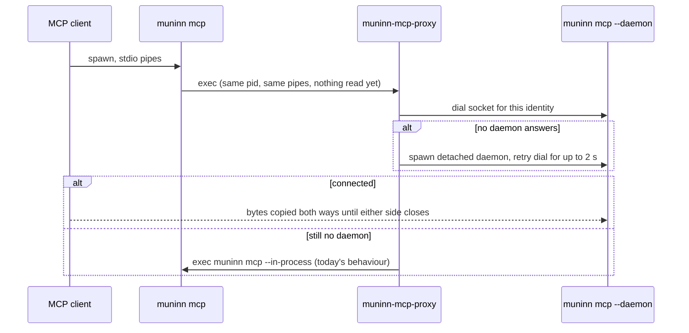

# Muninn Design: One Shared MCP Server for Every Client

**Status:** Design, not yet planned for implementation. Numbers marked
"measured" were taken on 2026-10-20 on one machine (316 repos, 875 MB
index, muninn from Homebrew); everything else is projected.

## TL;DR

Run one muninn MCP daemon per user and index, reached over a Unix
socket, and turn `muninn mcp` into a thin forwarder that pipes stdio to
it. Client configs don't change. The forwarder has to be a separate,
small binary that `muninn mcp` execs into, because anything that links
Zoekt pays about 26 MB at package init before `main` runs, which would
eat half the saving.

## Problem

Every MCP client session starts its own `muninn mcp`, and each one opens
its own Zoekt searcher over the whole index. On 2026-10-20 one machine
had 17 of them, one per Anvil instance, each with a physical footprint
of 55–61 MB (measured with `footprint`). That's about 1 GB for 17
identical copies of the same read-only state, and it grows with the
number of agent sessions, not the size of the index. Anvil's ADR 0005
(cross-instance sharing) decided that muninn's sharing belongs in
muninn, so every MCP client benefits, not only Anvil.

Where one process's 61 MB goes (measured):

| Part | Size | Shared by a daemon? |
| --- | --- | --- |
| Heap retained by package init (go-enry language tables, pulled in by the `zoekt` root package) | 12–13 MB live, ~26 MB footprint with no other work | Yes, if the forwarder doesn't link Zoekt |
| Searcher state for 316 shards | ~9 MB live (22 MB total live heap after load and GC) | Yes |
| GC headroom and runtime overhead | the rest, ~30 MB idle, more after queries (71 MB after two greps) | Yes |
| Shard pages | ~14 MB resident, file-backed and clean | Already shared by the OS |

Two things follow from this. A daemon removes almost all of the per-
session cost, but only if the per-session process stays out of the Zoekt
import graph. And GC tuning alone (`GOMEMLIMIT=32MiB` brought one process
from 61 MB to 45 MB, measured) can't get anywhere close, because the
live heap per process is already over 20 MB.

## Goals

- Many MCP clients share one searcher.
- `{"command": "muninn", "args": ["mcp"]}` keeps working unchanged in
  every stdio client (Anvil, Claude Code, Cursor).
- If the daemon can't be used, a session behaves exactly as it does
  today.

## Non-Goals

- Changing sync, indexing, or tool output.
- MCP over HTTP. No current client needs it, and on loopback it needs
  authentication that a Unix socket in a `0700` directory gets from the
  OS. It can be added to the same daemon later if a client appears that
  can't spawn a process.
- Windows or Linux service integration, and remote access.

## Why It Fits

- `mcp.Server` holds no per-session state (`internal/mcp/server.go:61`).
  Every handler re-reads the status file per call, and `search.Searcher`
  watches the index directory, so a long-lived process already picks up
  a concurrent sync.
- The go-sdk serves many sessions from one `sdk.Server`: `Server.Connect`
  takes any transport, including an `IOTransport` over a `net.Conn`.
- Sync runs separately under launchd and takes its own lock, so a
  long-lived reader doesn't change who writes the index.
- Opening the searcher is cheap: 68 ms for 316 shards, first search
  done at 71 ms (measured). Restarting a daemon costs nothing a user
  would notice, so the idle timeout can be short.

## Design

Three roles, two binaries. `muninn` keeps every command, including the
daemon. `muninn-mcp-proxy` is new: it imports only the standard library
and is installed next to `muninn` by the same Homebrew formula.

### Forwarder: `muninn mcp` execs into a small proxy

Go runs every package's `init` before `main`, so a `muninn mcp` that
merely forwards bytes still carries Zoekt's 26 MB. Making that import
lazy isn't possible within one binary. So `muninn mcp` does nothing but
`syscall.Exec` the proxy found next to its own resolved executable. The
init cost is paid for a few milliseconds and then the process image is
replaced. Because exec keeps the pid and the inherited stdio, the client
never notices.

The proxy dials the daemon, copies stdin to the socket and the socket to
stdout, and exits when either side closes. When it can't reach a daemon
it execs back into `<dir>/muninn mcp --in-process`. That is safe only
because it hasn't read a byte of stdin yet, so the rule is: **fall back
only before the first successful dial; after that, never.** If the
daemon dies mid-session the proxy exits, and the client sees the server
die exactly as it would today if `muninn mcp` crashed. Replaying
`initialize` against a new daemon can't restore in-flight requests, so
it isn't worth the complexity.

If the proxy binary is missing (a `go install` build, say), `muninn mcp`
serves in-process, as today.

### Identity: which daemon a session may join

Today each `muninn mcp` resolves its own paths from its own environment.
A shared daemon keeps the environment of whichever session started it,
so the socket must only be shared by sessions that would have resolved
the same thing. The socket name is a short hash of:

- the resolved real path of the `muninn` binary, plus its size and
  mtime. This changes on `brew upgrade` (new Cellar path) and on every
  local rebuild, so it needs no reliance on `Version`, which is `"dev"`
  for local builds (`internal/cli/root.go:13`);
- `xdg.IndexDir()`, `xdg.StatusPath()`, and `xdg.MirrorsDir()`.

Old daemons drain and exit idle after an upgrade. Same-identity only
means there's no wire or index-format compatibility to maintain between
proxy and daemon.

The socket and its lock live at `xdg.StateDir()/mcp-<hash>.sock` and
`.lock`. A 16-character hash keeps the path well under macOS's 104-byte
`sun_path` limit for any normal home directory; if the path is still too
long, the proxy falls back to in-process.

Config is not part of the identity: `muninn mcp` only loads it to fail
fast on a broken file, and the daemon re-validates it at start. `git` is
resolved from the daemon's `PATH`, which can differ from a later
session's. That's accepted; muninn needs a working `git`, not a
particular one.

### Daemon: one owner per identity, decided by the lock

The daemon, not the proxy, decides who serves:

1. Try to take `mcp-<hash>.lock` with `internal/lock`, retrying for up
   to 1 s (an exiting daemon may still hold it). If it's held, exit 0:
   another daemon owns this identity. If locking is unsupported, exit
   non-zero, and the proxy falls back to in-process.
2. Holding the lock, remove any stale socket file and listen.
3. Serve each connection as its own session on one shared `sdk.Server`.
4. When no connections have existed for 5 minutes, close the listener,
   remove the socket, and exit, releasing the lock with the process.

Holding the lock for the daemon's whole life is what makes the socket
file trustworthy: lock free means no live daemon, so a leftover socket
is stale and safe to delete. Proxies never touch the lock. Several
proxies racing to start a daemon each spawn one, one daemon wins, and
the rest exit within a second; every proxy is still retrying its dial
and connects to the winner.

The idle-exit race (a proxy dials just as the daemon closes its
listener) resolves itself: the dial fails, the proxy spawns a new
daemon, and that daemon waits out step 1's retry until the old one has
released the lock.

The proxy starts the daemon fully detached: its own session (`Setsid`),
stdin and stdout on `/dev/null`, stderr to `xdg.StateDir()/mcp.log`,
working directory `/`. If the daemon inherited the client's stdout pipe,
clients that wait for EOF on it would hang after their session ended,
and clients that signal their process group would kill a daemon other
sessions depend on.

### What one process serving many sessions changes

- **Panics.** The go-sdk doesn't recover panics in tool handlers, so
  today a panic kills one session and in a daemon it would kill all of
  them. `textHandler` (`internal/mcp/server.go:178`) recovers and turns
  a panic into a tool error.
- **Disconnects.** The go-sdk doesn't cancel in-flight requests when the
  client's side reaches EOF; it only cancels them when a write fails.
  Today that doesn't matter because the process exits. In the daemon,
  each connection gets its own context, cancelled as soon as a read on
  that connection returns EOF, so a long `git` call for a session that
  has gone away is killed instead of finishing for nobody.
- **History calls.** `search_commits` with `changed_regex` and similar
  calls run `git` per call. A semaphore around `gitcmd` (sized to
  `GOMAXPROCS`) stops 17 sessions from starting 17 pickaxe scans at
  once. Zoekt's searcher is built for concurrent queries and needs no
  limit.
- **Memory.** One daemon's heap now carries every session's in-flight
  results. The daemon sets a soft `GOMEMLIMIT` (64 MiB to start) so GC
  headroom doesn't grow unbounded under bursts.
- **Logging.** The daemon logs session open/close and errors to
  `mcp.log`; Zoekt's shard-loading noise stays discarded.

## Tradeoffs

| We gain | We accept |
| --- | --- |
| ~1 GB down to ~120 MB (projected) for 17 sessions | A second binary to build, ship, and keep next to `muninn` |
| One shard load instead of one per session | One crash or OOM now drops every session at once |
| | A background process that outlives the session that started it, for up to 5 idle minutes; `README.md:120` ("Nothing stays resident between sessions") needs rewording |
| | Exec-based handoff that only works on Unix, which is fine while scheduling is macOS-only |

## Testing

- Daemon and proxy in one test with a temp `XDG_STATE_HOME`: two
  sessions run tool calls concurrently and both get correct results.
- Stale socket with no lock holder is removed and replaced.
- Two daemons started at once: exactly one serves.
- Daemon killed mid-session: the proxy exits non-zero and doesn't fall
  back.
- No daemon possible (locking unsupported, path too long): `muninn mcp`
  serves in-process and the existing MCP tests pass through it.
- A handler panic returns a tool error and other sessions keep working.

## Success Measure

With the same 17 sessions, total footprint goes from about 1 GB to one
daemon (61 MB measured today for one process, plus whatever concurrency
adds) plus 17 proxies (3 MB each, measured for a standard-library-only
Go binary that copies stdio to a socket). Measure before and after with
`footprint` on every muninn process; the target is under 150 MB.

## Open Questions

- **Idle timeout.** 5 minutes is a guess. A 68 ms reload means a short
  timeout costs little; the open question is whether anything else
  (ctags, git mirrors) makes the first call after a restart slow.
- **Proxy naming and discovery.** `muninn-mcp-proxy` next to the real
  path of `muninn` works for Homebrew and goreleaser archives. Is there
  any install path where the two could end up in different directories?
